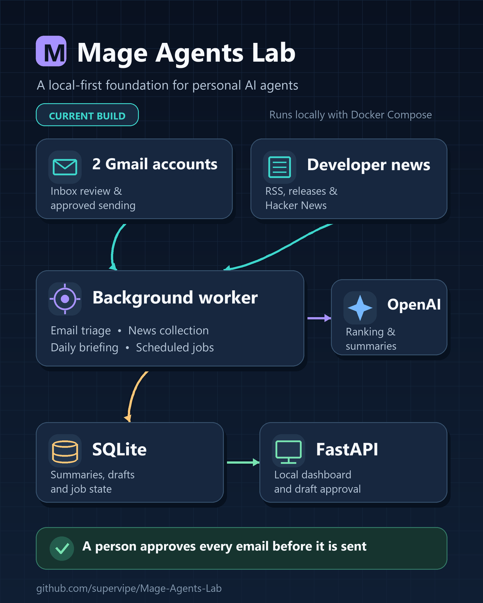

# Mage Agents Lab

**A local-first personal assistant, starting with email and developer news.** Mage Agents Lab is an evolving project for small, useful AI workflows that can run on a Linux computer. The current version combines scheduled background work with a local dashboard and keeps email sending behind an explicit approval step.



## What it does today

- **Email triage:** Checks two Gmail inboxes for new messages, screens sender and subject for importance, and summarizes selected messages for later review.
- **Developer news:** Collects AI, agent, framework, and software development updates from RSS feeds, GitHub releases, and Hacker News. The daily briefing includes source links.
- **Draft and approve:** Creates or suggests email drafts in the dashboard. A message is sent only after a person reviews and approves that specific draft.
- **Local dashboard:** Shows important mail, news, drafts, job status, Gmail connection status, and estimated OpenAI usage.

The first live worker pass completed both inbox jobs, news collection, and a daily digest. The earlier `/chat` route remains a learning prototype; the scheduled workflows use live services.

## How the pieces fit together

FastAPI serves the dashboard and draft actions. A separate worker polls Gmail and news sources, calls the OpenAI API for screening and summaries, and writes results to SQLite. Docker Compose runs the API and worker as separate services with persistent data and automatic restart. Gmail OAuth tokens are encrypted in the Docker data volume with a separate local key.

The API currently listens only on the Linux host's loopback address. It has no user login, so it should stay local until authentication and secure remote access are added. [Architecture and growth plan](docs/architecture.md) describes the next steps toward more agents, a desktop interface, and phone access.

## Privacy, control, and cost

The app sends sender and subject to OpenAI for initial screening. It sends message text only for emails selected for a detailed check. The local database saves metadata, classifications, summaries, drafts, and job state; it does not save full email bodies. OpenAI requests set `store: false`. See the [privacy notice](docs/privacy.md) for details.

The model cost guard estimates and records usage against a configurable monthly project budget. It is not an account-wide OpenAI billing limit. News summaries are based on feed excerpts and release notes, so the source links remain the place to read the full story.

## Where this is going

The first version is intentionally small. The next steps are a reusable contract for each agent's inputs, tools, schedule, budget, and approval rules; durable run records and database migrations; and authentication before any desktop or phone client connects remotely. A queue and PostgreSQL can be added when concurrent agents or devices make them necessary.

## Run on Linux

Install Docker Engine with the Compose plugin and Python 3. Create a private `.env` from `.env.example` with your Gmail account addresses and `OPENAI_API_KEY`, then place a Google OAuth **Desktop** client JSON in the project as `credentials.json`. Both files are ignored by Git. The OAuth app is currently in Google's **Testing** mode, so each account needs renewed consent about every seven days.

Generate a local encryption key and build the containers:

```bash
python3 scripts/init_linux_secrets.py
docker compose build
```

Connect each Gmail account. Run this command once per account, replacing the example address. Open the printed Google consent URL in a browser on the **same Linux computer** so the local callback can finish:

```bash
docker compose --profile auth run --rm auth --account "you@example.com"
```

Start the API and worker, then open <http://127.0.0.1:8000/> on that computer:

```bash
docker compose up -d api worker
docker compose ps
docker compose logs --tail=100 api worker
```

Compose exposes the dashboard only on `127.0.0.1` and restarts the services unless they are stopped. Keep the computer and Docker service running for scheduled work; jobs catch up after downtime. Set `TZ` in `.env` to change the daily digest time zone. To renew Gmail consent while the app remains in Testing, rerun the auth command for each account. `docker compose down` stops the services without deleting the named data volume.
