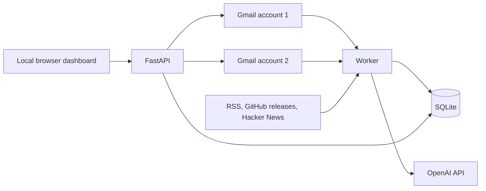

# Architecture and growth plan

## Current system

The FastAPI API, dashboard, worker, Gmail connector, OpenAI client, news collection, and SQLite storage are separate Python modules. Compose runs the API and worker as separate processes with persistent data and automatic container restart. This is enough for the first two Gmail accounts, a daily briefing, and a single local user. Drafts require an explicit approval action before Gmail sends them. The older chat route is a learning prototype and is not the scheduled agent platform.

## What is missing for a larger agent system

1. **Agent contract and job records.** Define each agent by its inputs, schedule or trigger, allowed tools, budget, output schema, and approval rules. Persist every run with status, timestamps, retries, and an idempotency key. Keep email sending behind a common approval service.
2. **Database migrations and stronger storage.** Add versioned migrations before changing the schema regularly. SQLite remains suitable for one laptop and a few workers. Move to PostgreSQL when multiple concurrent workers, remote clients, or more demanding queries make SQLite a bottleneck.
3. **Durable queue.** The present worker polls in one process. When agents need independent scheduling, parallelism, or long-running jobs, introduce a queue and separate worker pools. A Redis-backed worker library is an option at that point; it is not needed for the current volume.
4. **API identity and permissions.** A single-owner password-backed session protects the dashboard and API. Nord Meshnet can provide a private encrypted network between the Linux host and Windows/Ubuntu clients. Before wider sharing or public access, add stronger device/session management, HTTPS, rate limits, and explicit permissions for each agent action. Never publish the current API port to the internet.
5. **Client applications.** Keep FastAPI as the backend. The existing HTML dashboard can grow into a responsive web app first. A desktop wrapper or phone app can then use a stable, versioned API. For one phone, a private responsive web app may be simpler than maintaining a native mobile app.
6. **Operations.** Add structured logs, a health/status view for every agent, backup and restore for SQLite and token encryption keys, retention rules, and alerts when OAuth consent expires or an agent fails. Record real provider usage alongside the local cost estimate.

## Suggested order

Finish and observe the Gmail/news workflows first. Next, extract the agent contract and add database migrations. Test private Meshnet access on each client, then design a stable API contract for desktop and phone apps. Add a durable queue and PostgreSQL only when more agents or devices create measured contention. This keeps the current build inexpensive while preserving a clear path to grow.
